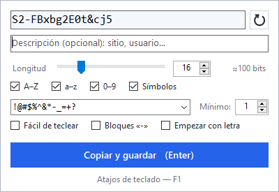
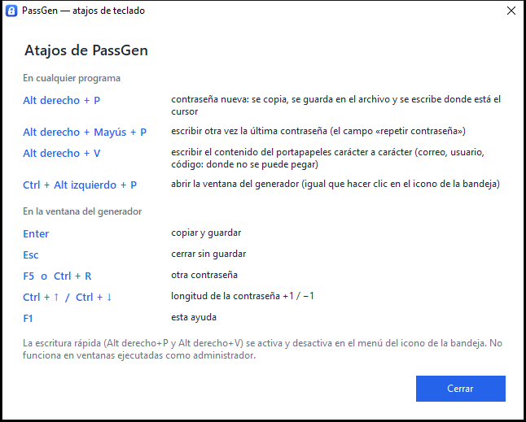
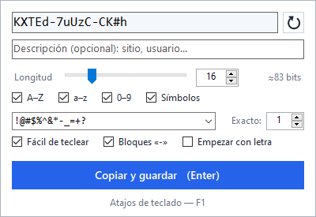
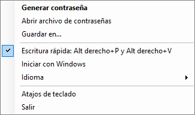

# PassGen

[English](README.md) · **Español** · [Русский](README.ru.md)

[](https://github.com/rodioniurev/passgen/actions/workflows/build.yml)
[](https://github.com/rodioniurev/passgen/releases)
[](LICENSE)


**Un generador de contraseñas diminuto para Windows que vive en la bandeja del sistema.** Un único `PassGen.exe` de unos 125 KB: sin instalador, sin internet y sin telemetría. La interfaz está en **español, inglés y ruso** y sigue el idioma de Windows.

<p align="center">
  
</p>

Pulsa un atajo y la contraseña está lista: se copia al portapapeles, se añade a un archivo de texto normal (`fecha - contraseña - descripción`) y, si quieres, **se escribe carácter a carácter** en el campo donde está el cursor. Esto último sirve para los sitios web que no te dejan pegar una contraseña (o un correo electrónico) desde el portapapeles.

## Contenido

[Características](#características) · [Descarga e instalación](#descarga-e-instalación) · [Atajos de teclado](#atajos-de-teclado) · [La ventana del generador](#la-ventana-del-generador) · [Escritura rápida](#escritura-rápida) · [Archivos y ajustes](#archivos-y-ajustes) · [Idioma](#idioma) · [Línea de comandos y autoinicio](#línea-de-comandos-y-autoinicio) · [Seguridad](#seguridad) · [Solución de problemas](#solución-de-problemas) · [Compilar desde el código fuente](#compilar-desde-el-código-fuente) · [Contribuir](#contribuir) · [Licencia](#licencia)

## Características

- **Una ventana rápida con todos los ajustes.** Se abre desde el icono de la bandeja o con `Ctrl + Alt izquierdo + P`. La contraseña se regenera con cada cambio; `Enter` significa «copiar y guardar».
- **Opciones flexibles:** longitud de 4 a 128; `A–Z`, `a–z`, `0–9` y caracteres especiales; tu propia lista de caracteres especiales permitidos (para sitios con restricciones) y su cantidad mínima; «empezar con letra»; estimación de la fortaleza en bits.
- **Modo «Fácil de teclear»:** sin caracteres parecidos (`0 O 1 l I |`), solo caracteres especiales sencillos, exactamente los que pidas. La contraseña se puede dividir en bloques `xxxxx-xxxxx-xxxx`.
- **Registro de contraseñas** en un archivo de texto: `2026-10-23 14:35:07 - contraseña - descripción`.
- **Escritura rápida sin abrir ninguna ventana:**
  - `Alt derecho + P` — contraseña nueva: al portapapeles, al archivo y escrita en el campo activo;
  - `Alt derecho + Mayús + P` — escribir otra vez la misma contraseña (el campo «repetir contraseña»);
  - `Alt derecho + V` — escribir el contenido del portapapeles carácter a carácter (un correo, un usuario, un código).
- **Generación criptográficamente segura** (`RandomNumberGenerator`, sin sesgo); cada conjunto de caracteres activado aparece en la contraseña.
- La contraseña **no llega** al historial del portapapeles de Windows (`Win + V`) ni al portapapeles en la nube.
- **No estorba:** al cerrarse la ventana, el cursor vuelve al programa en el que estabas.
- Interfaz en **español, inglés y ruso**, elegida automáticamente o desde el menú de la bandeja.
- Autoinicio opcional, una sola copia en ejecución, sin acceso a la red.

## Descarga e instalación

1. Descarga `PassGen.exe` desde la página de [Releases](https://github.com/rodioniurev/passgen/releases) (junto a él hay un archivo de suma de comprobación, `PassGen.exe.sha256`).
2. Ponlo en cualquier carpeta y haz doble clic. Junto al exe aparecen dos archivos: `passwords.txt` (el registro) y `PassGen.ini` (los ajustes).
3. Haz clic en el icono de la bandeja o pulsa `Ctrl + Alt izquierdo + P`.

Requiere Windows 7 o posterior con .NET Framework 4.x (viene incluido en Windows 10 y 11). Probado en Windows 10 22H2.

> **¿No ves el icono?** Windows 10 oculta los iconos nuevos tras la flecha «^»: arrastra el icono de PassGen a la barra de tareas.
>
> **¿Avisa el antivirus?** El programa instala un gancho de teclado para detectar `Alt derecho + P/V` y escribe texto, y eso le resulta sospechoso a algunos antivirus. El código fuente es abierto y el programa nunca usa la red. También puedes [compilarlo tú mismo](#compilar-desde-el-código-fuente): solo hace falta Windows.

Para desinstalar: si activaste *Iniciar con Windows*, desactívalo en el menú de la bandeja, elige *Salir* y borra la carpeta.

## Atajos de teclado

| Dónde | Teclas | Qué hace |
|---|---|---|
| En cualquier programa | `Alt derecho + P` | contraseña nueva: se copia, se guarda en el archivo y se escribe donde está el cursor |
| | `Alt derecho + Mayús + P` | escribir otra vez la última contraseña |
| | `Alt derecho + V` | escribir el contenido del portapapeles carácter a carácter |
| | `Ctrl + Alt izquierdo + P` | abrir la ventana del generador |
| En la ventana | `Enter` | copiar y guardar |
| | `Esc` | cerrar sin guardar |
| | `F5` o `Ctrl + R` | otra contraseña |
| | `Ctrl + ↑` / `Ctrl + ↓` | longitud de la contraseña +1 / −1 |
| | `F1` | esta ayuda |

Esta misma lista está dentro del programa: menú de la bandeja → *Atajos de teclado*, o `F1` en la ventana del generador.

<p align="center">
  
</p>

> En los teclados con AltGr (español, ruso «máquina de escribir», etc.) la tecla Alt derecha *es* AltGr, así que `Alt derecho + P/V` se interceptan en lugar de producir los caracteres de AltGr. `Ctrl + Alt izquierdo + P` y `Ctrl + Alt derecho + P` siguen abriendo la ventana. La escritura rápida se puede desactivar en el menú de la bandeja.

## La ventana del generador

<p align="center">
  
  &nbsp;
  
</p>

La ventana se cierra sola si haces clic fuera de ella. Cada cambio se guarda al instante en `PassGen.ini` y cambia la contraseña en el acto.

| Elemento | Qué hace |
|---|---|
| Campo de la contraseña | Muestra la contraseña. Puedes editarla (o pegar la tuya): se guarda y se copia lo que haya en el campo. |
| Botón de la flecha | Otra contraseña (`F5` o `Ctrl + R`). |
| Descripción | Nota opcional (sitio, usuario…). Se escribe en el archivo detrás de la contraseña. |
| Longitud | Un control deslizante (4–64) y un cuadro (4–128); `Ctrl + ↑` / `Ctrl + ↓` la cambian de 1 en 1. A su lado, la estimación de fortaleza (`≈ N bits`): gris a partir de 60 bits y roja por debajo. |
| `A–Z`, `a–z`, `0–9`, *Símbolos* | Conjuntos de caracteres. Siempre queda activo al menos uno. |
| Lista de símbolos | Qué caracteres especiales se pueden usar. Escribe los tuyos o elige un conjunto de la lista. Las letras, los dígitos y los espacios se ignoran. |
| *Mínimo* / *Exacto* | Cuántos caracteres especiales debe tener la contraseña. En el modo «Fácil de teclear» la etiqueta pasa a ser *Exacto*. |
| *Fácil de teclear* | Una contraseña más fácil de escribir a mano: véase abajo. |
| *Bloques «-»* | Divide la contraseña en grupos separados por guiones, p. ej. `4CwPG-ZWwmW-JJu#`. Los guiones cuentan en la longitud total. |
| *Empezar con letra* | El primer carácter es una letra (algunos sitios lo exigen). |
| *Copiar y guardar* (`Enter`) | Copia la contraseña, añade una línea al archivo, cierra la ventana y devuelve el cursor al programa en el que estabas. |

Cómo se forma una contraseña:

- Los caracteres salen de un generador criptográficamente seguro, sin sesgo.
- Cada conjunto activado aparece al menos una vez (los caracteres especiales, al menos el mínimo elegido); después todo se mezcla.
- **Fácil de teclear** es para contraseñas que tendrás que escribir a mano (un móvil, una tele, un ordenador ajeno): se quitan los caracteres parecidos `0 O 1 l I |`; solo se usan caracteres especiales sencillos (`! @ # $ % & * - _ + = ?`, sin paréntesis, comillas, barras, `^ ~` ni signos de puntuación); y hay **exactamente** los caracteres especiales indicados en el cuadro *Exacto* (uno por defecto); el resto son letras y dígitos.
- **Bloques:** la longitud total, guiones incluidos, es la elegida y los bloques tienen en promedio 4–5 caracteres (con longitud 16 sale `xxxxx-xxxxx-xxxx`). Las contraseñas de menos de 7 caracteres no llevan guiones.
- Ejemplos con longitud 16: normal `n_PyaW95$+J6DUKU`; *Fácil de teclear* `z5F#XPodAKuVNTj8`; *Fácil de teclear* + bloques `4CwPG-ZWwmW-JJu#`.

## Escritura rápida

Tres atajos funcionan en cualquier programa sin abrir la ventana; un pequeño aviso en la esquina inferior derecha confirma el resultado.

- **`Alt derecho + P` — contraseña nueva.** Se genera con los ajustes actuales de la ventana, se añade al archivo (la descripción es el **título de la ventana activa**, p. ej. `Crear cuenta — Firefox`; se desactiva con `autodesc=0`), se copia al portapapeles y **se escribe carácter a carácter** donde está el cursor.
- **`Alt derecho + Mayús + P` — la misma contraseña otra vez.** Para el campo «repetir contraseña»: pulsa `Tab` y luego este atajo. También funciona con una contraseña que confirmaste en la ventana. La última contraseña se guarda solo en memoria.
- **`Alt derecho + V` — escribir el portapapeles.** Para los sitios que te obligan a volver a escribir un correo, un usuario o un código y bloquean el pegado. Se recortan los espacios y saltos de línea de los extremos; los saltos de línea y tabulaciones interiores pasan a ser un espacio (un `Enter` de verdad podría enviar el formulario); se descartan los caracteres de control; máximo 500 caracteres; no se guarda nada y el portapapeles no cambia.

Conviene saber:

- Los caracteres se envían como «pulsaciones» Unicode, así que la distribución del teclado actual da igual.
- La escritura espera (hasta 1,5 s) a que sueltes `Alt`, `Mayús` y `Ctrl`; si otro programa toma el foco mientras se escribe, el resto **no** se escribe, para que una contraseña no acabe en la ventana equivocada.
- La velocidad es de 8 ms por carácter (unos 0,15 s para 16 caracteres); se cambia con `typedelay`.
- No funciona en ventanas ejecutadas como administrador ni en algunos escritorios remotos, máquinas virtuales y juegos.
- Si estos atajos chocan con otro programa, desactiva la escritura rápida en el menú de la bandeja.

## Archivos y ajustes

**`passwords.txt`** — el registro, junto al exe por defecto (se cambia desde el menú de la bandeja: *Guardar en…*). UTF-8 con BOM, una línea por contraseña:

```text
2026-10-23 14:35:07 - Xk9#mP2$vL8@qR4w
2026-10-23 14:36:12 - n_PyaW95$+J6DUKU - Crear cuenta — Firefox
```

Fecha y hora, luego la contraseña y después la descripción, si la hay, separadas por ` - `. Una contraseña nunca contiene espacios, así que la línea se divide sin problemas con `split(' - ', 3)`. Al archivo solo se le añaden líneas y puede estar abierto en un editor.

**`PassGen.ini`** — los ajustes, junto al exe; se reescribe con cada cambio. Edítalo a mano solo con PassGen cerrado (`PassGen.exe /exit`).

| Clave | Por defecto | Significado |
|---|---|---|
| `file` | `passwords.txt` junto al exe | Ruta completa del archivo de registro. |
| `length` | `16` | Longitud de la contraseña, 4–128. |
| `upper`, `lower`, `digits` | `1` | Conjuntos `A–Z`, `a–z`, `0–9` (`1` activado, `0` desactivado). |
| `symbols` | `1` | Caracteres especiales activados. |
| `symset` | `!@#$%^&*-_=+?` | Caracteres especiales permitidos. |
| `minsym` | `1` | Cuántos caracteres especiales, 1–8. |
| `easy` | `0` | Modo «Fácil de teclear». |
| `blocks` | `0` | Bloques separados por guiones. |
| `letter` | `0` | Empezar con letra. |
| `quick` | `1` | Escritura rápida (`Alt derecho + P/V`) activada. |
| `autodesc` | `1` | `Alt derecho + P` escribe como descripción el título de la ventana activa. |
| `typedelay` | `8` | Pausa entre caracteres escritos, en ms, 0–200. Súbela si un programa pierde caracteres. |
| `lang` | `auto` | Idioma de la interfaz: `auto` (el de Windows), `en`, `es` o `ru`. |

## Idioma

La interfaz está disponible en **español**, **inglés** y **ruso**. Por defecto PassGen sigue el idioma de visualización de Windows (cualquier otro idioma cae en inglés). Para cambiarlo: menú de la bandeja → *Idioma* → *Automático*, *English*, *Español* o *Русский* (o escribe `lang=` en `PassGen.ini`). El cambio se aplica al instante.

Para añadir otro idioma basta con añadir una columna a la tabla de [`src/Loc.cs`](src/Loc.cs); `tests/LocalizationTests.ps1` comprueba que no falte ninguna traducción.

## Línea de comandos y autoinicio

| Comando | Qué hace |
|---|---|
| `PassGen.exe` | Inicia el programa y abre la ventana (o abre la ventana de la copia en ejecución). |
| `PassGen.exe /autostart` | Inicia sin ventana: solo el icono de la bandeja. Es lo que usa el autoinicio. |
| `PassGen.exe /exit` | Cierra limpiamente la copia en ejecución y quita el icono de la bandeja. Útil en scripts y antes de actualizar el exe. |

*Iniciar con Windows* (menú de la bandeja) añade un valor `PassGen` con `"ruta\PassGen.exe" /autostart` en `HKCU\Software\Microsoft\Windows\CurrentVersion\Run`. Si mueves el exe, desactiva y vuelve a activar el autoinicio.

## Seguridad

PassGen **no es un gestor de contraseñas**. Las contraseñas se escriben en un archivo de texto **en claro**, a propósito: es un registro cómodo de «qué generé y cuándo», no una caja fuerte. Por eso:

- guarda el archivo en una unidad cifrada (BitLocker, etc.) y **nunca en una carpeta sincronizada con la nube**;
- no publiques nunca `passwords.txt` ni `PassGen.ini` (ambos están en `.gitignore`);
- la contraseña permanece en el portapapeles hasta que otra cosa la reemplace;
- el título de ventana que escribe `Alt derecho + P` puede contener texto delicado: desactívalo con `autodesc=0`.

Lo que el programa **no hace**: no se conecta a la red, no registra las pulsaciones de teclas y no guarda nada salvo las contraseñas y los ajustes. El gancho de teclado solo mira `P`, `V` y las teclas modificadoras, y deja pasar todo lo demás sin tocarlo ([`KeyHook`](src/QuickInput.cs)). Más información en [SECURITY.md](SECURITY.md).

## Solución de problemas

- **No hay icono en la bandeja.** Mira tras la flecha «^» y arrastra el icono a la barra de tareas.
- **`Ctrl + Alt izquierdo + P` no hace nada.** Otro programa tiene ese atajo (entonces el aviso del icono no lo menciona). Abre la ventana con un clic en el icono.
- **`Alt derecho + P/V` no hacen nada.** Comprueba que la escritura rápida esté activada en el menú de la bandeja; la ventana activa puede estar ejecutándose como administrador; otro programa (AutoHotkey, un gestor de contraseñas…) puede haberse quedado con el atajo; o el antivirus bloqueó el gancho: añade PassGen a sus exclusiones.
- **La contraseña se escribe incompleta o en el sitio equivocado.** No mantengas pulsadas `Alt` y `Mayús`: la escritura empieza cuando las sueltas. Si un programa pierde caracteres (escritorios remotos, máquinas virtuales), sube `typedelay`. Si la ventana activa cambia durante la escritura, el resto no se escribe a propósito.
- **El sitio rechaza la contraseña.** Prueba otra lista de caracteres especiales (a menudo basta con `!@#$%`), el modo *Fácil de teclear* o una longitud menor.
- **Títulos de ventana raros en el registro.** Es `Alt derecho + P`; pon `autodesc=0` para desactivarlo.

## Compilar desde el código fuente

Solo necesitas Windows con .NET Framework 4.x: ni Visual Studio ni SDK.

```text
git clone https://github.com/rodioniurev/passgen.git
cd passgen
build.bat
```

Se obtiene `PassGen.exe` (se usa el compilador de C# 5 incluido en Windows). Pruebas:

```text
powershell -NoProfile -ExecutionPolicy Bypass -File tests\GeneratorTests.ps1
powershell -NoProfile -ExecutionPolicy Bypass -File tests\LocalizationTests.ps1
```

Detalles: [docs/building.md](docs/building.md) · cómo funciona por dentro: [docs/architecture.md](docs/architecture.md) (en inglés; también en ruso: [compilación](docs/building.ru.md), [arquitectura](docs/architecture.ru.md)).

## Contribuir

Se agradecen los informes de errores, las ideas, las traducciones y los pull requests: véase [CONTRIBUTING.md](CONTRIBUTING.md). Las vulnerabilidades, por favor, de forma privada, como se explica en [SECURITY.md](SECURITY.md). Historial: [CHANGELOG.md](CHANGELOG.md).

## Licencia

[MIT](LICENSE) © 2026 Rodion Iurev.
