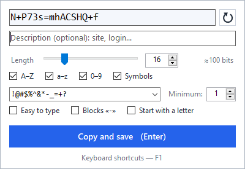
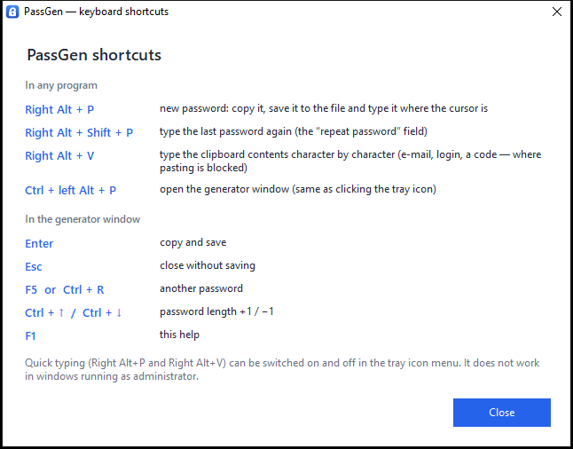
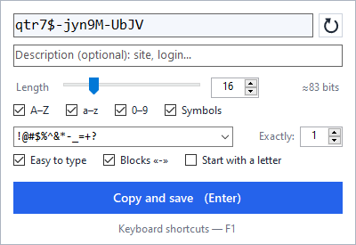
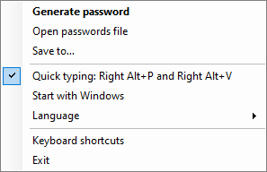

# PassGen

**English** · [Español](README.es.md) · [Русский](README.ru.md)

[](https://github.com/rodioniurev/passgen/actions/workflows/build.yml)
[](https://github.com/rodioniurev/passgen/releases)
[](LICENSE)


**A tiny password generator for Windows that lives in the system tray.** One ~125 KB `PassGen.exe` — no installer, no internet, no telemetry. The interface speaks **English, Spanish and Russian** and follows your Windows language.

<p align="center">
  
</p>

Press a hotkey and the password is ready: it is copied to the clipboard, appended to a plain text file (`date - password - description`) and — if you want — **typed character by character** into the field under the cursor. That last part is for websites that won't let you paste a password (or an e-mail address) from the clipboard.

## Contents

[Features](#features) · [Download and install](#download-and-install) · [Keyboard shortcuts](#keyboard-shortcuts) · [The generator window](#the-generator-window) · [Quick typing](#quick-typing) · [Files and settings](#files-and-settings) · [Language](#language) · [Command line and autostart](#command-line-and-autostart) · [Security](#security) · [Troubleshooting](#troubleshooting) · [Building from source](#building-from-source) · [Contributing](#contributing) · [License](#license)

## Features

- **A quick window with all the settings.** Open it from the tray icon or with `Ctrl + left Alt + P`. The password regenerates on every change; `Enter` means "copy and save".
- **Flexible options:** length 4–128; `A–Z`, `a–z`, `0–9` and special characters; your own list of allowed special characters (for sites with restrictions) and their minimum count; "start with a letter"; a strength estimate in bits.
- **"Easy to type" mode:** no look-alike characters (`0 O 1 l I |`), only simple special characters — exactly as many as you ask for. The password can be split into `xxxxx-xxxxx-xxxx` blocks.
- **A password log** in a text file: `2026-10-23 14:35:07 - password - description`.
- **Quick typing without opening a window:**
  - `Right Alt + P` — a new password: to the clipboard, to the file, and typed into the focused field;
  - `Right Alt + Shift + P` — type the same password again (the "repeat password" field);
  - `Right Alt + V` — type the clipboard contents character by character (an e-mail, a login, a code).
- **Cryptographically secure generation** (`RandomNumberGenerator`, no modulo bias); every enabled character set is represented in each password.
- The password is **kept out of** Windows clipboard history (`Win + V`) and the cloud clipboard.
- **Does not get in the way:** when the window closes, focus returns to the program you were working in.
- **English, Spanish and Russian** interface, chosen automatically or from the tray menu.
- Optional autostart, a single running copy, no network access.

## Download and install

1. Download `PassGen.exe` from the [Releases](https://github.com/rodioniurev/passgen/releases) page (next to it there is a `PassGen.exe.sha256` checksum).
2. Put it in any folder and double-click it. Two files appear next to it: `passwords.txt` (the log) and `PassGen.ini` (settings).
3. Click the tray icon or press `Ctrl + left Alt + P`.

Requires Windows 7 or newer with .NET Framework 4.x (built into Windows 10 and 11). Tested on Windows 10 22H2.

> **Can't see the icon?** Windows 10 hides new tray icons behind the "^" arrow — drag the PassGen icon onto the taskbar.
>
> **Antivirus warning?** The program installs a keyboard hook to catch `Right Alt + P/V` and types text, which looks suspicious to some antivirus products. The source code is open, and the program never touches the network. You can also [build it yourself](#building-from-source) — nothing but Windows is needed.

To uninstall: if you enabled *Start with Windows*, switch it off in the tray menu, then choose *Exit* and delete the folder.

## Keyboard shortcuts

| Where | Keys | What it does |
|---|---|---|
| Any program | `Right Alt + P` | new password: copy it, save it to the file and type it where the cursor is |
| | `Right Alt + Shift + P` | type the last password again |
| | `Right Alt + V` | type the clipboard contents character by character |
| | `Ctrl + left Alt + P` | open the generator window |
| In the window | `Enter` | copy and save |
| | `Esc` | close without saving |
| | `F5` or `Ctrl + R` | another password |
| | `Ctrl + ↑` / `Ctrl + ↓` | password length +1 / −1 |
| | `F1` | this help |

The same list is built into the program: tray menu → *Keyboard shortcuts*, or `F1` in the generator window.

<p align="center">
  
</p>

> On keyboard layouts with AltGr (Spanish, Russian "typewriter", etc.) the right Alt key *is* AltGr, so `Right Alt + P/V` are intercepted instead of producing AltGr characters. `Ctrl + left Alt + P` and `Ctrl + right Alt + P` still open the window. Quick typing can be switched off in the tray menu.

## The generator window

<p align="center">
  
  &nbsp;
  
</p>

The window closes by itself when you click elsewhere. Every change is saved to `PassGen.ini` immediately and changes the password at once.

| Control | What it does |
|---|---|
| Password field | Shows the password. You may edit it (or paste your own): what is in the field is what gets saved and copied. |
| Arrow button | Another password (`F5` or `Ctrl + R`). |
| Description | Optional note (site, login…). Written to the file after the password. |
| Length | A slider (4–64) and a box (4–128); `Ctrl + ↑` / `Ctrl + ↓` change it by 1. Next to it: a strength estimate (`≈ N bits`), grey from 60 bits and red below. |
| `A–Z`, `a–z`, `0–9`, *Symbols* | Character sets. At least one always stays on. |
| Symbol list | Which special characters may be used. Type your own or pick a ready-made set from the list. Letters, digits and spaces in it are ignored. |
| *Minimum* / *Exactly* | How many special characters the password needs. In "Easy to type" mode the label becomes *Exactly*. |
| *Easy to type* | A password that is easier to type by hand — see below. |
| *Blocks «-»* | Split the password into hyphen-separated groups, e.g. `4CwPG-ZWwmW-JJu#`. Hyphens count toward the total length. |
| *Start with a letter* | The first character is a letter (some sites require it). |
| *Copy and save* (`Enter`) | Copies the password, appends a line to the file, closes the window and returns the cursor to the program you were in. |

How a password is built:

- Characters come from a cryptographically secure generator, without bias.
- Every enabled set is represented at least once (special characters — at least the chosen minimum); then everything is shuffled.
- **Easy to type** is for passwords you will have to enter by hand (a phone, a TV, someone else's computer): look-alikes `0 O 1 l I |` are removed; only simple special characters are used (`! @ # $ % & * - _ + = ?` — no brackets, quotes, slashes, `^ ~` or punctuation); and there are **exactly** as many special characters as set in the *Exactly* box (one by default), the rest being letters and digits.
- **Blocks:** the total length including hyphens equals the chosen length and blocks average 4–5 characters (length 16 gives `xxxxx-xxxxx-xxxx`). Passwords shorter than 7 characters get no hyphens.
- Examples at length 16: normal `n_PyaW95$+J6DUKU`; *Easy to type* `z5F#XPodAKuVNTj8`; *Easy to type* + blocks `4CwPG-ZWwmW-JJu#`.

## Quick typing

Three shortcuts work in any program without opening the window; a small toast in the bottom-right corner confirms the result.

- **`Right Alt + P` — a new password.** It is created using the current settings of the window, appended to the file (the description is the **title of the active window**, e.g. `Sign up — Firefox`; turn this off with `autodesc=0`), copied to the clipboard and **typed character by character** where the cursor is.
- **`Right Alt + Shift + P` — the same password again.** For the "repeat password" field: press `Tab`, then this. It also works with a password you confirmed in the window. The last password is kept in memory only.
- **`Right Alt + V` — type the clipboard.** For sites that make you retype an e-mail, a login or a code and block pasting. Surrounding spaces and line breaks are trimmed; inner line breaks and tabs become a space (a real `Enter` could submit the form); control characters are dropped; at most 500 characters; nothing is saved and the clipboard is not changed.

Good to know:

- Characters are sent as Unicode "key presses", so the current keyboard layout doesn't matter.
- Typing waits (up to 1.5 s) until you release `Alt`, `Shift` and `Ctrl`; if another program takes the focus while typing, the rest is **not** typed, so a password can't land in the wrong window.
- Speed is 8 ms per character (about 0.15 s for 16 characters); change it with `typedelay`.
- It does not work in windows running as administrator, nor in some remote desktops, virtual machines and games.
- If these shortcuts clash with another program, switch quick typing off in the tray menu.

## Files and settings

**`passwords.txt`** — the log, next to the exe by default (change it from the tray menu: *Save to…*). UTF-8 with BOM, one line per password:

```text
2026-10-23 14:35:07 - Xk9#mP2$vL8@qR4w
2026-10-23 14:36:12 - n_PyaW95$+J6DUKU - Sign up — Firefox
```

Date and time, then the password, then the description if there is one, separated by ` - `. A password never contains spaces, so a line splits cleanly with `split(' - ', 3)`. The file is only appended to and can stay open in an editor.

**`PassGen.ini`** — settings, next to the exe, rewritten on every change. Edit it by hand only while PassGen is closed (`PassGen.exe /exit`).

| Key | Default | Meaning |
|---|---|---|
| `file` | `passwords.txt` next to the exe | Full path of the log file. |
| `length` | `16` | Password length, 4–128. |
| `upper`, `lower`, `digits` | `1` | Sets `A–Z`, `a–z`, `0–9` (`1` on, `0` off). |
| `symbols` | `1` | Special characters on. |
| `symset` | `!@#$%^&*-_=+?` | Allowed special characters. |
| `minsym` | `1` | How many special characters, 1–8. |
| `easy` | `0` | "Easy to type" mode. |
| `blocks` | `0` | Hyphen-separated blocks. |
| `letter` | `0` | Start with a letter. |
| `quick` | `1` | Quick typing (`Right Alt + P/V`) is on. |
| `autodesc` | `1` | `Right Alt + P` writes the active window's title as the description. |
| `typedelay` | `8` | Pause between typed characters in ms, 0–200. Raise it if a program drops characters. |
| `lang` | `auto` | Interface language: `auto` (Windows language), `en`, `es` or `ru`. |

## Language

The interface is available in **English**, **Spanish** and **Russian**. By default PassGen follows the Windows display language (any other language falls back to English). To change it: tray menu → *Language* → *Automatic*, *English*, *Español* or *Русский* (or set `lang=` in `PassGen.ini`). The change applies at once.

Adding another language means adding one column to the table in [`src/Loc.cs`](src/Loc.cs); `tests/LocalizationTests.ps1` checks that no translation is missing.

## Command line and autostart

| Command | What it does |
|---|---|
| `PassGen.exe` | Starts the program and opens the window (or opens the window of the running copy). |
| `PassGen.exe /autostart` | Starts without a window — only the tray icon. This is what autostart uses. |
| `PassGen.exe /exit` | Closes the running copy cleanly and removes the tray icon. Handy in scripts and before updating the exe. |

*Start with Windows* (tray menu) adds a `PassGen` value with `"path\PassGen.exe" /autostart` to `HKCU\Software\Microsoft\Windows\CurrentVersion\Run`. If you move the exe, switch autostart off and on again.

## Security

PassGen is **not a password manager**. Passwords are written to a plain text file **in clear text**, by design: it is a convenient "what did I generate and when" log, not a vault. So:

- keep the file on an encrypted drive (BitLocker, etc.) and **never in a cloud-synced folder**;
- never publish `passwords.txt` or `PassGen.ini` (both are in `.gitignore`);
- the password stays on the clipboard until something else replaces it;
- the window title written by `Right Alt + P` may contain sensitive text — disable it with `autodesc=0`.

What the program **does not do**: it makes no network connections, does not record keystrokes and stores nothing but passwords and settings. The keyboard hook looks only at `P`, `V` and modifier keys and passes everything else through untouched ([`KeyHook`](src/QuickInput.cs)). More in [SECURITY.md](SECURITY.md).

## Troubleshooting

- **No tray icon.** Look behind the "^" arrow and drag the icon onto the taskbar.
- **`Ctrl + left Alt + P` does nothing.** Another program owns that shortcut (the tray tooltip then doesn't list it). Open the window by clicking the icon.
- **`Right Alt + P/V` do nothing.** Check that quick typing is on in the tray menu; the active window may be running as administrator; another program (AutoHotkey, a password manager…) may have grabbed the shortcut; or the antivirus blocked the hook — add PassGen to its exclusions.
- **The password is typed incompletely or in the wrong place.** Don't keep `Alt` and `Shift` held — typing starts when they are released. If a program drops characters (remote desktops, virtual machines), raise `typedelay`. If the active window changes during typing, the rest is deliberately not typed.
- **The site rejects the password.** Try another special-character list (often `!@#$%` is enough), the *Easy to type* mode or a shorter length.
- **Strange window titles in the log.** That is `Right Alt + P`; set `autodesc=0` to turn it off.

## Building from source

You need only Windows with .NET Framework 4.x — no Visual Studio, no SDK:

```text
git clone https://github.com/rodioniurev/passgen.git
cd passgen
build.bat
```

This produces `PassGen.exe` (the in-box C# 5 compiler is used). Tests:

```text
powershell -NoProfile -ExecutionPolicy Bypass -File tests\GeneratorTests.ps1
powershell -NoProfile -ExecutionPolicy Bypass -File tests\LocalizationTests.ps1
```

Details: [docs/building.md](docs/building.md) · how it works inside: [docs/architecture.md](docs/architecture.md). Both are also available in Russian: [building](docs/building.ru.md), [architecture](docs/architecture.ru.md).

## Contributing

Bug reports, ideas, translations and pull requests are welcome — see [CONTRIBUTING.md](CONTRIBUTING.md). Please report vulnerabilities privately, as described in [SECURITY.md](SECURITY.md). History: [CHANGELOG.md](CHANGELOG.md).

## License

[MIT](LICENSE) © 2026 Rodion Iurev.
