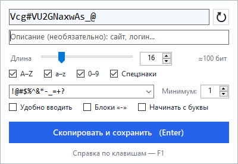
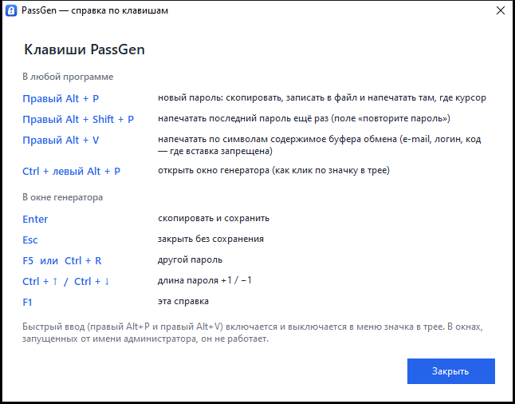
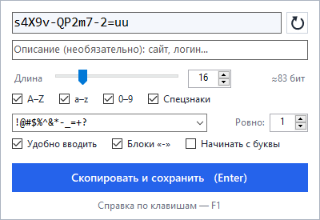
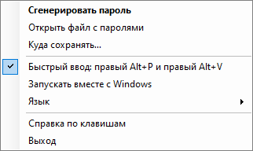

# PassGen

[English](README.md) · [Español](README.es.md) · **Русский**

[](https://github.com/rodioniurev/passgen/actions/workflows/build.yml)
[](https://github.com/rodioniurev/passgen/releases)
[](LICENSE)


**Маленький генератор паролей для Windows, который живёт в трее.** Один файл `PassGen.exe` (около 125 КБ): не нужны ни установщик, ни интернет, никакой телеметрии. Интерфейс на **русском, английском и испанском** — язык выбирается по языку Windows.

<p align="center">
  
</p>

Нажали сочетание клавиш — пароль готов: он скопирован в буфер обмена, записан в обычный текстовый файл (`дата - пароль - описание`) и, если нужно, **напечатан по символам** туда, где стоит курсор. Последнее — для сайтов, которые не дают вставлять пароль (или e-mail) из буфера обмена.

## Содержание

[Возможности](#возможности) · [Скачать и установить](#скачать-и-установить) · [Клавиши](#клавиши) · [Окно генератора](#окно-генератора) · [Быстрый ввод](#быстрый-ввод) · [Файлы и настройки](#файлы-и-настройки) · [Язык](#язык) · [Командная строка и автозапуск](#командная-строка-и-автозапуск) · [Безопасность](#безопасность) · [Если что-то не работает](#если-что-то-не-работает) · [Сборка из исходников](#сборка-из-исходников) · [Участие в разработке](#участие-в-разработке) · [Лицензия](#лицензия)

## Возможности

- **Быстрое окно со всеми настройками.** Открывается по значку в трее или по `Ctrl + левый Alt + P`. Пароль пересоздаётся при любом изменении, `Enter` — «скопировать и сохранить».
- **Гибкие настройки:** длина 4–128; наборы `A–Z`, `a–z`, `0–9` и спецзнаки; свой список допустимых спецзнаков (для сайтов с ограничениями) и минимальное их число; «начинать с буквы»; оценка стойкости в битах.
- **Режим «Удобно вводить»:** без похожих знаков (`0 O 1 l I |`), только простые спецзнаки, и их ровно столько, сколько указано. Пароль можно разбить на блоки `xxxxx-xxxxx-xxxx`.
- **Журнал паролей** в текстовом файле: `2026-10-23 14:35:07 - пароль - описание`.
- **Быстрый ввод без окна:**
  - `Правый Alt + P` — новый пароль: в буфер, в файл и по символам в поле ввода;
  - `Правый Alt + Shift + P` — тот же пароль ещё раз (поле «повторите пароль»);
  - `Правый Alt + V` — напечатать по символам содержимое буфера (e-mail, логин, код).
- **Криптостойкая генерация** (`RandomNumberGenerator`, без смещения вероятностей); в каждом пароле есть знак из каждого включённого набора.
- Пароль **не попадает** в историю буфера обмена Windows (`Win + V`) и в облачный буфер.
- **Не мешает работе:** после закрытия окна курсор возвращается в программу, где вы были.
- Интерфейс на **русском, английском и испанском**: выбирается автоматически или в меню значка.
- Автозапуск вместе с Windows (по желанию), одна копия программы, никакой сети.

## Скачать и установить

1. Откройте страницу [Releases](https://github.com/rodioniurev/passgen/releases) и скачайте `PassGen.exe` (рядом лежит контрольная сумма `PassGen.exe.sha256`).
2. Положите файл в любую папку и запустите двойным щелчком. Рядом появятся `passwords.txt` (журнал) и `PassGen.ini` (настройки).
3. Кликните по значку в трее или нажмите `Ctrl + левый Alt + P`.

Нужна Windows 7 или новее с .NET Framework 4.x (он есть в Windows 10 и 11). Проверялось на Windows 10 22H2.

> **Не видно значка?** Windows 10 прячет новые значки под стрелкой «^» — перетащите значок PassGen на панель задач.
>
> **Ругается антивирус?** Программа ставит клавиатурный хук для `Правый Alt + P/V` и печатает текст — некоторым антивирусам это кажется подозрительным. Исходники открыты, сеть программа не использует. Можно [собрать exe самостоятельно](#сборка-из-исходников) — для этого нужна только Windows.

Чтобы удалить: если включали «Запускать вместе с Windows», выключите это в меню значка, затем выберите «Выход» и удалите папку.

## Клавиши

| Где | Клавиши | Что делает |
|---|---|---|
| В любой программе | `Правый Alt + P` | новый пароль: скопировать, записать в файл и напечатать там, где курсор |
| | `Правый Alt + Shift + P` | напечатать последний пароль ещё раз |
| | `Правый Alt + V` | напечатать по символам содержимое буфера обмена |
| | `Ctrl + левый Alt + P` | открыть окно генератора |
| В окне | `Enter` | скопировать и сохранить |
| | `Esc` | закрыть без сохранения |
| | `F5` или `Ctrl + R` | другой пароль |
| | `Ctrl + ↑` / `Ctrl + ↓` | длина пароля +1 / −1 |
| | `F1` | эта справка |

Тот же список есть в самой программе: меню значка → «Справка по клавишам» или `F1` в окне генератора.

<p align="center">
  
</p>

> На раскладках с AltGr (испанская, русская «машинопись» и др.) правый Alt и есть AltGr: сочетания `Правый Alt + P/V` программа перехватывает вместо обычных знаков AltGr. `Ctrl + левый Alt + P` и `Ctrl + правый Alt + P` по-прежнему открывают окно. Быстрый ввод можно выключить в меню значка.

## Окно генератора

<p align="center">
  
  &nbsp;
  
</p>

Окно закрывается само, если кликнуть мимо него. Все изменения сразу сохраняются в `PassGen.ini` и сразу меняют пароль.

| Элемент | Что делает |
|---|---|
| Поле пароля | Показывает пароль. Его можно править (или вставить свой): сохраняется и копируется то, что в поле. |
| Кнопка со стрелкой | Другой пароль (`F5` или `Ctrl + R`). |
| Описание | Необязательная пометка (сайт, логин…). Записывается в файл после пароля. |
| Длина | Ползунок 4–64 и поле 4–128; `Ctrl + ↑` / `Ctrl + ↓` меняют длину на 1. Рядом оценка стойкости (`≈ N бит`): серая от 60 бит, красная ниже. |
| `A–Z`, `a–z`, `0–9`, «Спецзнаки» | Наборы знаков. Хотя бы один набор всегда остаётся включённым. |
| Список спецзнаков | Какие спецзнаки можно использовать. Впишите свои или выберите готовый набор из списка. Буквы, цифры и пробелы в нём игнорируются. |
| «Минимум» / «Ровно» | Сколько спецзнаков нужно в пароле. В режиме «Удобно вводить» подпись меняется на «Ровно». |
| «Удобно вводить» | Пароль, который проще набрать руками, — см. ниже. |
| «Блоки «-»» | Разбить пароль на группы через дефис, например `4CwPG-ZWwmW-JJu#`. Дефисы входят в общую длину. |
| «Начинать с буквы» | Первый знак — буква (так требуют некоторые сайты). |
| «Скопировать и сохранить» (`Enter`) | Копирует пароль, дописывает строку в файл, закрывает окно и возвращает курсор в программу, где вы были. |

Как собирается пароль:

- Знаки выбираются криптостойким генератором без смещения вероятностей.
- В пароле есть хотя бы один знак из каждого включённого набора (спецзнаков — не меньше заданного минимума); затем всё перемешивается.
- **«Удобно вводить»** — для паролей, которые придётся набирать вручную (телефон, телевизор, чужой компьютер): убираются похожие знаки `0 O 1 l I |`; остаются только простые спецзнаки (`! @ # $ % & * - _ + = ?` — без скобок, кавычек, слэшей, `^ ~` и знаков препинания); спецзнаков **ровно** столько, сколько указано в поле «Ровно» (по умолчанию один), остальное — буквы и цифры.
- **«Блоки»:** общая длина вместе с дефисами равна выбранной, блоки в среднем по 4–5 знаков (при длине 16 получится `xxxxx-xxxxx-xxxx`). У паролей короче 7 знаков дефисов нет.
- Примеры для длины 16: обычный `n_PyaW95$+J6DUKU`; «Удобно вводить» `z5F#XPodAKuVNTj8`; «Удобно вводить» + блоки `4CwPG-ZWwmW-JJu#`.

## Быстрый ввод

Три сочетания работают в любой программе, окно при этом не открывается; результат подтверждает небольшая плашка в правом нижнем углу.

- **`Правый Alt + P` — новый пароль.** Генерируется по текущим настройкам окна, дописывается в файл (описание — **заголовок активного окна**, например `Регистрация — Firefox`; отключается параметром `autodesc=0`), копируется в буфер и **печатается по символам** там, где курсор.
- **`Правый Alt + Shift + P` — тот же пароль ещё раз.** Для поля «повторите пароль»: нажмите `Tab`, затем это сочетание. Работает и с паролем, который вы подтвердили в окне. Последний пароль хранится только в памяти.
- **`Правый Alt + V` — напечатать содержимое буфера.** Для сайтов, которые требуют ввести e-mail, логин или код «руками» и запрещают вставку. Пробелы и переводы строк по краям убираются; переводы строк и табуляции внутри заменяются пробелом (настоящий `Enter` мог бы отправить форму); управляющие знаки выбрасываются; не больше 500 знаков; ничего не сохраняется, буфер не меняется.

Что нужно знать:

- Знаки отправляются как Unicode-«нажатия», поэтому текущая раскладка (русская, английская) не важна.
- Печать ждёт (не дольше 1,5 с), пока вы отпустите `Alt`, `Shift` и `Ctrl`; если во время печати фокус перешёл в другую программу, остаток **не** печатается — пароль не попадёт в чужое окно.
- Скорость — 8 мс на знак (около 0,15 с на 16 знаков); меняется параметром `typedelay`.
- Не работает в окнах, запущенных от имени администратора, а также в части удалённых рабочих столов, виртуальных машин и игр.
- Если сочетания мешают другой программе, выключите быстрый ввод в меню значка.

## Файлы и настройки

**`passwords.txt`** — журнал, по умолчанию рядом с exe (меняется в меню значка: «Куда сохранять…»). UTF-8 с BOM, по строке на пароль:

```text
2026-10-23 14:35:07 - Xk9#mP2$vL8@qR4w
2026-10-23 14:36:12 - n_PyaW95$+J6DUKU - Регистрация — Firefox
```

Дата и время, затем пароль, затем описание (если есть), разделитель — ` - `. Пароль не содержит пробелов, поэтому строку легко разобрать: `split(' - ', 3)`. Файл только дополняется и может быть открыт в редакторе.

**`PassGen.ini`** — настройки, рядом с exe, переписываются при каждом изменении. Править вручную можно только при закрытой программе (`PassGen.exe /exit`).

| Ключ | По умолчанию | Значение |
|---|---|---|
| `file` | `passwords.txt` рядом с exe | Полный путь к файлу журнала. |
| `length` | `16` | Длина пароля, 4–128. |
| `upper`, `lower`, `digits` | `1` | Наборы `A–Z`, `a–z`, `0–9` (`1` — включён, `0` — выключен). |
| `symbols` | `1` | Спецзнаки включены. |
| `symset` | `!@#$%^&*-_=+?` | Допустимые спецзнаки. |
| `minsym` | `1` | Сколько спецзнаков, 1–8. |
| `easy` | `0` | Режим «Удобно вводить». |
| `blocks` | `0` | Блоки через дефис. |
| `letter` | `0` | Начинать с буквы. |
| `quick` | `1` | Быстрый ввод (`Правый Alt + P/V`) включён. |
| `autodesc` | `1` | `Правый Alt + P` пишет в описание заголовок активного окна. |
| `typedelay` | `8` | Пауза между напечатанными знаками, мс, 0–200. Увеличьте, если программа «глотает» знаки. |
| `lang` | `auto` | Язык интерфейса: `auto` (язык Windows), `en`, `es` или `ru`. |

## Язык

Интерфейс доступен на **русском**, **английском** и **испанском**. По умолчанию PassGen следует языку интерфейса Windows (любой другой язык заменяется английским). Сменить язык: меню значка → «Язык» → «Автоматически», English, Español или «Русский» (или укажите `lang=` в `PassGen.ini`). Изменение применяется сразу.

Чтобы добавить ещё один язык, достаточно дописать колонку в таблицу [`src/Loc.cs`](src/Loc.cs); `tests/LocalizationTests.ps1` проверит, что ни один перевод не пропущен.

## Командная строка и автозапуск

| Команда | Что делает |
|---|---|
| `PassGen.exe` | Запускает программу и открывает окно (или открывает окно уже работающей копии). |
| `PassGen.exe /autostart` | Запускает без окна, только значок в трее. С этим параметром работает автозапуск. |
| `PassGen.exe /exit` | Корректно закрывает работающую копию и убирает значок из трея. Удобно в скриптах и перед обновлением exe. |

«Запускать вместе с Windows» (меню значка) добавляет значение `PassGen` с командой `"путь\PassGen.exe" /autostart` в `HKCU\Software\Microsoft\Windows\CurrentVersion\Run`. Если перенесли exe, выключите и снова включите автозапуск.

## Безопасность

PassGen — **не менеджер паролей**. Пароли пишутся в обычный текстовый файл **в открытом виде** — так задумано: это удобный журнал «что и когда я сгенерировал», а не хранилище. Поэтому:

- держите файл на зашифрованном диске (BitLocker и т. п.) и **не кладите его в папки с облачной синхронизацией**;
- не публикуйте `passwords.txt` и `PassGen.ini` (в `.gitignore` они уже есть);
- пароль остаётся в буфере обмена, пока его не заменит что-то другое;
- заголовок окна, который пишет `Правый Alt + P`, может содержать чувствительный текст — отключите его параметром `autodesc=0`.

Чего программа **не делает**: не обращается к сети, не записывает нажатия клавиш и не хранит ничего, кроме паролей и настроек. Клавиатурный хук смотрит только на `P`, `V` и клавиши-модификаторы, остальное пропускает не глядя ([`KeyHook`](src/QuickInput.cs)). Подробнее — в [SECURITY.md](SECURITY.md).

## Если что-то не работает

- **Нет значка в трее.** Загляните под стрелку «^» и перетащите значок на панель задач.
- **`Ctrl + левый Alt + P` ничего не открывает.** Сочетание занято другой программой (тогда в подсказке значка его нет). Открывайте окно кликом по значку.
- **`Правый Alt + P/V` ничего не делают.** Проверьте, что быстрый ввод включён в меню значка; в активном окне может быть программа «от администратора»; сочетание могла перехватить другая программа (AutoHotkey, менеджер паролей…); либо антивирус заблокировал хук — добавьте PassGen в исключения.
- **Пароль печатается не полностью или не туда.** Не держите `Alt` и `Shift` — печать начинается, когда их отпустили. Если программа «глотает» знаки (удалённые рабочие столы, виртуальные машины), увеличьте `typedelay`. Если за время печати активным стало другое окно, остаток не печатается — так задумано.
- **Сайт не принимает пароль.** Попробуйте другой список спецзнаков (часто достаточно `!@#$%`), режим «Удобно вводить» или меньшую длину.
- **В журнале странные заголовки окон.** Это `Правый Alt + P`; отключается параметром `autodesc=0`.

## Сборка из исходников

Нужна только Windows с .NET Framework 4.x — ни Visual Studio, ни SDK:

```text
git clone https://github.com/rodioniurev/passgen.git
cd passgen
build.bat
```

Получится `PassGen.exe` (используется штатный компилятор C# 5). Тесты:

```text
powershell -NoProfile -ExecutionPolicy Bypass -File tests\GeneratorTests.ps1
powershell -NoProfile -ExecutionPolicy Bypass -File tests\LocalizationTests.ps1
```

Подробности: [docs/building.ru.md](docs/building.ru.md) · как всё устроено внутри: [docs/architecture.ru.md](docs/architecture.ru.md) (есть и английские версии: [building](docs/building.md), [architecture](docs/architecture.md)).

## Участие в разработке

Сообщения об ошибках, идеи, переводы и pull request'ы приветствуются — см. [CONTRIBUTING.md](CONTRIBUTING.md). О уязвимостях, пожалуйста, сообщайте приватно, как описано в [SECURITY.md](SECURITY.md). История изменений: [CHANGELOG.md](CHANGELOG.md).

## Лицензия

[MIT](LICENSE) © 2026 Rodion Iurev.
